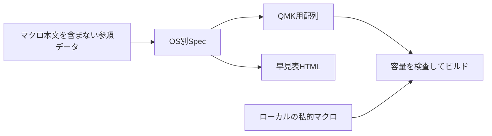

# CoreX v0.13.0 配列を使う

Keyball44の`hamanori_corex`は、2026-11-06に読み戻したCoreX v0.13.0の配列を基準にする（`corex-rmk`の`0e7cc27`）。Mac／Windowsの通常・編集・記号・数字・マウス・設定を各6レイヤーに配置した。操作は[早見表](keyball44-cheatsheet.html)でMac／Windowsを切り替えて参照する。



## Keyballでの対応

- Tab／右引用符の長押しで編集、かな／Enterで記号、英数で数字。長押しの判定はCoreXの現行LTと同じ200ms・Permissive Hold。コンボの判定はKeyball従来の30msを維持した。
- 編集層のVは最初のキーを離してから180ms待ち、1回なら通常の貼り付け、時間内の2回押しなら書式なしの貼り付けを1回送る。U／Oは1回で行頭／行末、2回で段落先頭／末尾。Shiftで選択を広げられる。
- ボールを動かすとマウス層へ入り、Kの長押しで数字とスクロール。ドラッグ固定は通常の左クリックで解除する。精密モードは通常入力か明示解除まで維持する。
- 左Shift＋バックスラッシュを押している間は設定層。WでOS切替、PでF16、左端3キーで音量＋／−／消音。
- OSはUSB接続時の判定で選び、設定層のWでも手動切替できる。手動指定はUSBを挿し直すまで有効。WindowsはJIS設定のまま使い、US記号の意味はファーム側で変換する。iPad専用の動作は設けない。
- 設定のカーソル速度・スクロール量・ジェスチャー感度・AML（自動マウスレイヤー）・スクロール反転はKeyball側の機構を使う。スクロール量だけEEPROMへ保存し、他の調整と手動OS指定は挿し直すと初期状態へ戻る。
- 接続設定、BLE、全消去は置かない。左の追加の親指キーはOpt／Cmd、右下の親指キーはCoreXでEnterの外側にあるF16（音声入力）へ割り当てる。KeyballにはCoreXの左外側の親指キーがないため、Macの単独Ctrlはない。
- 4種類のジェスチャーを移植。MacのフルスクリーンON/OFFにはCoreXと同じBTT設定が必要。
- OLEDは左にレイヤー・OS・修飾キー、右にジェスチャー・ボール状態・CPIとスクロール量を表示する。大きな文字を維持し、ロゴと詳細なショートカット表示を省いた。容量に収めるため、専用フォントで必要な英大文字と数字だけを描く。

## ジェスチャー

マウス層で対象キーを押しながらボールを動かす。動かすたびに1回発動し、発動後300msは次の動きを受け付けない。斜めは方向がはっきりするまで判定を待つ。動かさずに180ms以内に2回押すと2回押しの操作になる。

| キー | 種類 | 上／下 | 左／右 | 2回押し |
| --- | --- | --- | --- | --- |
| I | 画面 | 全体一覧／アプリの窓（Windowsはデスクトップ表示） | デスクトップ移動 | デスクトップ表示 |
| O | ウィンドウ | フルスクリーンON／OFF（Windowsは最大化／復元） | 左半分／右半分 | フルスクリーン解除・復元 |
| , | タブ | 前／次のタブ | 戻る／進む | 再読み込み |
| U | ズーム | 拡大／縮小 | 等倍 | 等倍 |

Macのウィンドウ操作はCoreXと同じBTT設定を使う（ON=`⌃⌥⌘F18`、OFF=`⌃⌥⌘F17`、2回押し=`⌃⌥⌘F16`）。Windowsの復元は`Win+↓`で、通常の大きさの窓では最小化される場合がある。アプリごとの選択境界やショートカット対応はOSとアプリに従う。

## 再生成と検証

参照データは`reference/corex/corex-v0.13.0-20261106.json`。マクロ本文とデバイス識別情報は含めない。生成されたSpec、Cの配列、HTMLは直接編集しない。

```sh
sh keyball44/doc/tools/corex/regen.sh
uv run --no-project python -m unittest discover -s keyball44/doc/tools/corex/tests -p 'test_*.py'
sh keyball44/doc/tools/corex/tests/test_edit.sh
sh keyball44/doc/tools/corex/tests/test_gestures.sh
QMK_ROOT="$HOME/qmk_firmware" sh keyball44/doc/tools/corex/tests/test_runtime.sh
```

QMK本体は既存のcheckoutを使う。検証済みの版は`ca4541699915b37cd1f253bbed51854627efd2ce`。`build.sh`はこのKeyball checkoutのキーマップを渡し、出力を指定フォルダへ分ける。

```sh
sh keyball44/doc/tools/corex/build.sh "$HOME/qmk_firmware" /private/path/to/build
```

2026-11-07の私的マクロ入りビルドは28,580 / 28,672バイト。空きは92バイトで、文字列や機能を増やす場合も実ビルドの容量チェックを通す。この版はCoreX編集10・ジェスチャー11・QMK入口を通す統合6・生成5・私的ビルド入力2の計34項目が成功した（同日時点で実機へは未書き込み）。独立レビューで見つかった左クリックでのドラッグ固定解除、精密モード中のAML保持、QMKの弱修飾クリアをまたぐAlt保持は修正し、失敗するテストから成功へ変わることを確認した。

## 私的な文字列コンボ

A+S+D+FとJ+K+L+;は、CoreXのマクロ0・1に対応する。ローカルのバックアップから次のヘッダーだけを生成する。

```sh
uv run --no-project python keyball44/doc/tools/corex/prepare_private.py \
  /private/path/to/corex-backup.json \
  qmk_firmware/keyboards/keyball/keyball44/keymaps/hamanori_corex/secrets.h
```

`secrets.h`はGit対象外、0600で保存する。ヘッダーがないビルドでは2つの文字列コンボは入力しない。マクロを含むHEX、ELF、バックアップは公開しない。

## 実機の受け入れ

新しい配列は左右へ同じHEXを書き込んで使う。ビルド成功とホストテストは、実機へ書き込んだ証拠ではない。書き込み後はavrdudeの検証に加え、Mac／Windowsで長押し、記号、編集、クリック、スクロール、4種のジェスチャー、OS切替と修飾キーの解除を確認する。更新前のHEXを別の場所へ保存してから作業する。

ブラウザーではMac／Windows切替と320px幅でページ全体に横はみ出しがないことを確認済み（2026-11-07時点）。iPhone実機での閲覧、物理キーとOS・アプリでの動作は未確認。実機未確認の項目をビルド成功だけで完了扱いにしない。

## 復旧

今回の更新前へ戻す場合は、`/Users/hamanori/keyball-backups/corex-v0130-20261107/rollback-94024d0.hex`を左右へ書き込む。更新前の版は左`94024d0`、右`1dd2ed7`で、差はOLEDの向きだけ。旧Remap版と左右別のVIA設定は`/Users/hamanori/.codex/visualizations/2026/11/03/keyball-mac-port/`にある。旧設定はマクロを含むので公開・commitしない。

### Remap時代の状態へ戻す

Keyballのキー配置はUSBをつないだ側の半分のEEPROMへ保存されるため、バックアップは左（Windowsで使っていた側）と右（Macで使っていた側）に分かれている。道具とバックアップは上のフォルダにあり、以下はそのフォルダで実行する。

1. 左右それぞれUSBをつなぎ、`./flash.sh firmware-before/keyball_keyball44_hamanori.hex 120`を実行してからリセットを素早く2回押す。VIA対応のRemap版ファームへ戻る。
2. 左半分をUSBにつなぎ、`uv run --no-project --with hidapi python via_restore.py 0x5957 0x0400 keyball-windows-backup-before-20261103.json --dry-run`で差分を確かめ、`--dry-run`を外して書き戻す。キー配置とマクロ（11・12を含む）を書き、読み戻して一致を確かめる。マクロの中身は画面へ出さない。
3. 右半分をUSBにつなぎ、同じように`keyball-mac-backup-before-20261103.json`を書き戻す。
4. Remapで配置が元どおりか確かめる。カーソル速度などのKeyball独自の設定はファームの初期値へ戻る。
