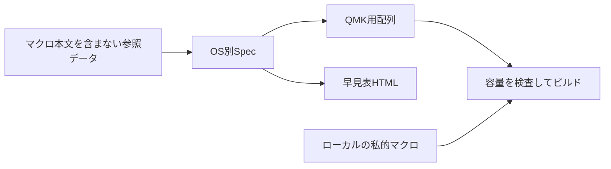

# CoreX v0.13.0 配列を使う

Keyball44の`hamanori_corex`は、2026-11-06に読み戻したCoreX v0.13.0の配列を基準にする。Mac／Windowsの通常・編集・記号・数字・マウス・設定を各6レイヤーに配置した。操作は[早見表](keyball44-cheatsheet.html)を参照する。



## Keyballでの対応

- Tab／右引用符の長押しで編集、かな／Enterで記号、英数で数字。長押しの判定は200ms。
- ボールを動かすとマウス層へ入り、Kの長押しで数字とスクロール。ドラッグ固定は通常の左クリックで解除する。精密モードは通常入力か明示解除まで維持する。
- 左Shift＋バックスラッシュを押している間は設定層。WでOS切替、PでF16、左端3キーで音量＋／−／消音。
- 接続設定、BLE、全消去は置かない。追加の親指キーは左Opt／CmdとCtrl相当へ割り当てる。
- 4種類のジェスチャーを移植。MacのフルスクリーンON/OFFにはCoreXと同じBTT設定が必要。
- OLEDは左にレイヤー・OS・修飾キー、右にジェスチャー・ボール状態・CPIとスクロール量を表示する。大きな文字を維持し、ロゴと詳細なショートカット表示を省いた。

## 再生成と検証

参照データは`reference/corex/corex-v0.13.0-20261106.json`。マクロ本文とデバイス識別情報は含めない。生成されたSpec、Cの配列、HTMLは直接編集しない。

```sh
sh keyball44/doc/tools/corex/regen.sh
uv run --no-project python -m unittest discover -s keyball44/doc/tools/corex/tests -p 'test_*.py'
sh keyball44/doc/tools/corex/tests/test_edit.sh
sh keyball44/doc/tools/corex/tests/test_gestures.sh
QMK_ROOT="$HOME/qmk_firmware" sh keyball44/doc/tools/corex/tests/test_runtime.sh
```

QMK本体は既存のcheckoutを使う。検証済みの版は`ca4541699915b37cd1f253bbed51854627efd2ce`。`build.sh`はこのKeyball checkoutのキーマップを渡し、出力を指定フォルダへ分ける。

```sh
sh keyball44/doc/tools/corex/build.sh "$HOME/qmk_firmware" /private/path/to/build
```

2026-11-07の私的マクロ入りビルドは28,580 / 28,672バイト。空きは92バイトで、文字列や機能を増やす場合も実ビルドの容量チェックを通す。

## 私的な文字列コンボ

A+S+D+FとJ+K+L+;は、CoreXのマクロ0・1に対応する。ローカルのバックアップから次のヘッダーだけを生成する。

```sh
uv run --no-project python keyball44/doc/tools/corex/prepare_private.py \
  /private/path/to/corex-backup.json \
  qmk_firmware/keyboards/keyball/keyball44/keymaps/hamanori_corex/secrets.h
```

`secrets.h`はGit対象外、0600で保存する。ヘッダーがないビルドでは2つの文字列コンボは入力しない。マクロを含むHEX、ELF、バックアップは公開しない。

## 実機の受け入れ

新しい配列は左右へ同じHEXを書き込んで使う。ビルド成功とホストテストは、実機へ書き込んだ証拠ではない。書き込み後はavrdudeの検証に加え、Mac／Windowsで長押し、記号、編集、クリック、スクロール、4種のジェスチャー、OS切替と修飾キーの解除を確認する。更新前のHEXを別の場所へ保存してから作業する。
