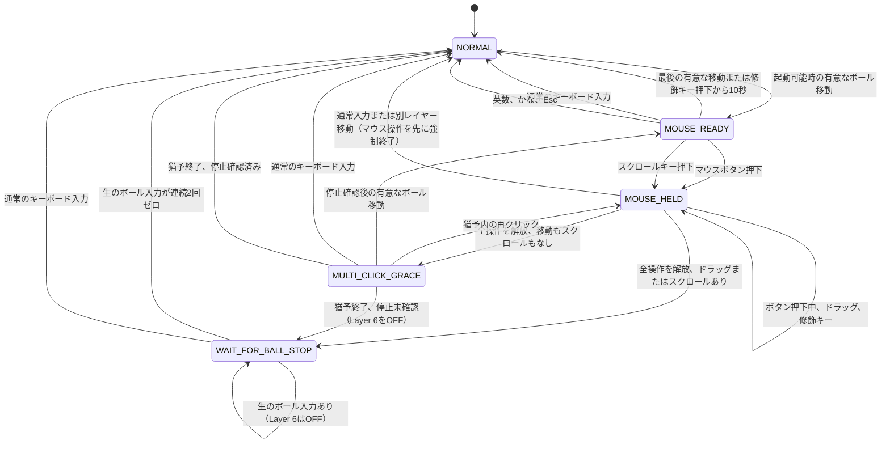

# Keyball44 マウスセッション仕様

| 項目 | 内容 |
| --- | --- |
| 状態 | 実装済み、実機確認待ち |
| 実装 | `hamanori_optimized`、QMK 0.22.14でビルド確認済み |
| 対象 | Keyball44 `hamanori` キーマップ |
| 目的 | 修飾キー付きクリックを可能にしながら、マウス操作後に通常入力へ安全に戻す |

## 操作の全体像

ボールを動かしてからクリック操作を終えるまでを、1回の**マウスセッション**として扱う。

クリック前の待機時間は10秒とする。

クリック中とドラッグ中は時間で終了しない。

通常のクリック後には、ダブルクリックを受け付ける短い猶予を設ける。

```text
ボールを動かす
  ↓
10秒以内なら、クリック先を確認しながら待てる
  ↓
Ctrl / Shift / Option / Commandを組み合わせてクリックできる
  ↓
クリックまたはドラッグを終える
  ↓
通常入力へ戻る
```

## 状態遷移



## 各状態の責務

**`NORMAL`**：通常のキーマップを使用する。

通常キーを押しておらず、Layer 1からLayer 5も有効でないときに有意なボール移動を検出すると、`MOUSE_READY`へ移る。

通常キーを一つでも押している間は、ボールを動かしてもマウスセッションを開始しない。

純粋な修飾キーだけを押している場合は、マウスセッションを開始できる。

純粋な修飾キーには、左右の`Ctrl`、`Shift`、`Alt / Option`、`GUI / Command / Win`と、ホールドに確定した同種のMod-Tapを含む。

**`MOUSE_READY`**：マウスボタン、スクロール、修飾キー付きマウス操作を受け付ける。

最後の有意なボール移動または修飾キー押下から10秒経過すると、`NORMAL`へ戻る。

有意なボール移動を検出するたびに、10秒の計測を最初からやり直す。

**`MOUSE_HELD`**：一つ以上のマウスボタンまたはスクロールキーを押している状態を表す。

すべてのマウスボタンとスクロールキーを解放するまで、時間経過では終了しない。

最後の操作を解放した時点で、ボタン押下中の累積移動がしきい値未満であり、スクロールも行っていなければ`MULTI_CLICK_GRACE`へ移る。

累積移動がしきい値以上だった場合、または一度でもスクロールを行った場合は`WAIT_FOR_BALL_STOP`へ移る。

通常入力または別レイヤーへの移動を要求された場合は、押下中のマウス操作をPCへ解放してから`NORMAL`へ移る。

**`MULTI_CLICK_GRACE`**：通常クリックの直後に、次のクリックを受け付ける。

初期値は500msとし、実機確認後に調整する。

状態へ入った直後は、クリックキー解放時の振動を新しい操作として扱わない。

生のボール入力が連続2回ゼロになった後、有意な移動を検出した場合だけ`MOUSE_READY`へ戻る。

Layer 6はONのままとし、猶予中は左右、戻る、進むの各マウスボタンを再び押せる。

同じボタンを押せば連続クリックになり、別のボタンを押せば新しいマウス操作として`MOUSE_HELD`へ移る。

500msの猶予が終わった時点でボール停止を確認済みなら、Layer 6をOFFにして`NORMAL`へ移る。

停止を確認できていなければ、Layer 6をOFFにして`WAIT_FOR_BALL_STOP`へ移る。

**`WAIT_FOR_BALL_STOP`**：ボタン解放時の振動やドラッグの慣性で、マウスレイヤーが直ちに再起動することを防ぐ。

Layer 6はこの状態へ入る前にOFFにする。

生のボール入力はPCへ送るが、マウスセッションの再起動には使用しない。

生のボール入力が連続2回ゼロになったことを確認してから、`NORMAL`へ戻る。

この状態では通常レイヤーのキー配置を使用する。

純粋な修飾キーはPCへ通して状態を変えず、それ以外のキー入力はPCへ通して直ちに`NORMAL`へ移る。

Layer 6がOFFのため、マウスボタン用の物理位置を押した場合も通常レイヤーの文字入力として扱う。

## 入力ごとの動作

次の表は状態ごとの差を含む。

`MOUSE_HELD`と`WAIT_FOR_BALL_STOP`では、各状態の規則を優先する。

| 入力 | マウスセッション | タイマー | PCへ送る入力 |
| --- | --- | --- | --- |
| 有意なボール移動 | `NORMAL`では開始、`MOUSE_READY`では維持、停止確認済みの猶予中は再開 | `MOUSE_READY`の期限を10秒へ戻す | ポインター移動 |
| `Ctrl`押下 | 待機状態を維持 | `MOUSE_READY`は10秒、連続クリック猶予は500msへ戻す | `Ctrl` |
| `Shift`押下 | 待機状態を維持 | `MOUSE_READY`は10秒、連続クリック猶予は500msへ戻す | `Shift` |
| `Option / Alt`押下 | 待機状態を維持 | `MOUSE_READY`は10秒、連続クリック猶予は500msへ戻す | `Option / Alt` |
| `Command / Win`押下 | 待機状態を維持 | `MOUSE_READY`は10秒、連続クリック猶予は500msへ戻す | `Command / Win` |
| 修飾キー解放 | 状態を変更しない | 変更しない | 修飾キー解放 |
| マウスボタン押下 | `MOUSE_HELD`へ移る | 停止 | ボタン押下 |
| 最後のマウス操作を解放 | 連続クリック猶予または停止待ちへ移る | 状態に応じて再開 | ボタン解放またはスクロール終了 |
| 他のマウス操作を保持中に一つだけ解放 | `MOUSE_HELD`を維持 | 停止 | 対応する操作の解放 |
| スクロールキー押下 | `MOUSE_HELD`へ移る | 停止 | スクロール開始 |
| 感度または速度の調整キー | 調整後に終了 | 破棄 | 設定変更のみ |
| 英数、かな | 終了 | 破棄 | 入力モード切替 |
| `Esc` | 終了 | 破棄 | `Esc` |
| その他の通常キー | 終了 | 破棄 | QMKがLayer 6の透過位置から解決したキー入力 |
| 別レイヤーへの移動 | 終了 | 破棄 | 指定レイヤーの操作 |

修飾キーを押している間も、10秒の計測自体は止めない。

`MOUSE_READY`で修飾キーを押した場合は、残り時間を10秒へ戻す。

`MULTI_CLICK_GRACE`で修飾キーを押した場合は、連続クリック猶予を500msへ戻す。

修飾キーの解放では期限を変更しない。

修飾キーを押下状態のままにしても期限が進むため、マウスセッションは最終的に終了する。

マウスボタン、ドラッグ、スクロールの操作中だけは、10秒の計測を停止する。

通常キーを押している間は、`NORMAL`でボール移動を検出してもマウスセッションを開始しない。

この抑止には文字、数字、記号、レイヤー操作を含め、純粋な修飾キーは含めない。

## 押下中にEXITする場合

通常入力または別レイヤーへの移動は、マウスボタンやスクロールキーの押下中にも要求できる。

Mouse Session Moduleは、次の順序でマウス操作を終了する。

```text
on(keyboard_intent_while_mouse_held)
  send release for every held mouse button
  stop scroll conversion
  remember physically held mouse keys
  turn Layer 6 OFF
  enter NORMAL
  pass the resolved keyboard event to QMK

on(later_physical_release_of_forced_button)
  clear remembered physical hold
  do not send a second mouse-button release
```

この順序により、PC側にマウスボタンの押下状態を残さず、EXITを起こしたキー入力も失わない。

物理解放を待たずに送ったボタン解放と停止したスクロールキーは、物理キー位置ごとに記録する。

そのキーを実際に離したときは、Layer 6解除後に解決される下位レイヤーのキーコードを含め、解放イベント全体をQMKへ渡さない。

これにより、マウスボタンの重複解放だけでなく、押下していない`J`や`K`などのキー解放がPCへ漏れることも防ぐ。

抑止記録はキーコードではなく、行と列で表した物理キー位置で管理する。

## 主な操作例

### 通常クリック

```text
ボール移動
  MOUSE_READY
左ボタン押下
  MOUSE_HELD
左ボタン解放
  MULTI_CLICK_GRACE
ボール停止を確認した後、500ms経過
  NORMAL
```

クリック前には最大10秒待てる。

クリック後は約500msで通常入力へ戻る。

500msの時点でボール停止を確認できていない場合だけは、Layer 6をOFFにしたまま`WAIT_FOR_BALL_STOP`で停止を待つ。

### Ctrlクリック

```text
ボール移動
  MOUSE_READY
Ctrl押下
  MOUSE_READYのまま、タイマーを10秒へ戻す
左ボタン押下
  Ctrl + 左ボタンを送信
左ボタン解放
  MULTI_CLICK_GRACE
```

`Ctrl`を押してもマウスレイヤーを解除しない。

同じ規則を`Shift`、`Option / Alt`、`Command / Win`にも適用する。

### ドラッグ

```text
ボール移動
  MOUSE_READY
左ボタン押下
  MOUSE_HELD
ボタンを押したままボール移動
  ドラッグ、時間制限なし
左ボタン解放
  WAIT_FOR_BALL_STOP
生のボール入力が連続2回ゼロ
  NORMAL
```

ボタン解放をPCへ送ってからマウスレイヤーを解除する。

順序を逆にすると、ボタン解放を送れずにドラッグ状態が残る可能性がある。

### ダブルクリック

```text
1回目のクリック解放
  MULTI_CLICK_GRACE
500ms以内に同じボタンを再度押下
  MOUSE_HELD
2回目のクリック解放
  MULTI_CLICK_GRACE
ボール停止を確認した後、500ms経過
  NORMAL
```

`MULTI_CLICK_GRACE`は、OS側のダブルクリック判定時間より短くならない値へ調整する。

ファームウェアが保証するのは、設定時間内の2組のボタン押下と解放を欠落なく送ることまでとする。

OSがダブルクリックとして解釈する条件は、OSの設定と対象アプリを固定した実機試験で確認する。

### 右クリックメニュー

```text
右クリック
  MULTI_CLICK_GRACE
メニュー項目へボール移動
  MULTI_CLICK_GRACEのまま、または停止確認後にMOUSE_READY
500ms以内に左クリック
  項目を選択
```

500msを過ぎた場合は、ボール停止を確認して`NORMAL`へ戻った後の有意な移動で、新しいマウスセッションが始まる。

## Mod-TapとLayer-Tap

タップとホールドで役割が変わるキーは、確定した役割に従ってマウスセッションを処理する。

```text
Mod-Tap
  tap  → 通常キーとして扱い、EXIT
  hold → 純粋な修飾キーとして扱い、維持

Layer-Tap
  tap  → 通常キーとして扱い、EXIT
  hold → マウスセッションを終了し、指定レイヤーへ移る
```

たとえば`LCTL_T(KC_LNG2)`は、タップなら英数入力へ切り替えてEXITし、ホールドなら`Ctrl`としてマウスセッションを維持する。

タップとホールドの判定には、既存の`TAPPING_TERM`を使用する。

現在の`TAPPING_TERM`は200msであり、`HOLD_ON_OTHER_KEY_PRESS`は有効、`QUICK_TAP_TERM`は0である。

判定が確定していないMod-Tapが、10秒の待機期限または500msの連続クリック猶予をまたぐ場合は、判定が確定するまでその期限の処理を保留する。

タップに確定した場合はEXITし、ホールドに確定した場合は修飾キーまたはレイヤー操作の規則を適用する。

保留時間の上限は`TAPPING_TERM`とし、未確定状態を無期限に維持しない。

連続クリック猶予中にMod-Tapがホールドへ確定した場合は、確定時点から猶予を500msへ戻す。

タップへ確定した場合は、対応する入力を送ってEXITする。

Layer-Tapはタップとホールドのどちらでもマウスセッションを終了するため、押下時点でLayer 6をOFFにする。

QMKはその後でタップまたはホールドを判定し、確定したキー入力またはレイヤー操作を実行する。

未確定のMod-Tapとマウスボタンが同じ走査周期で処理され、`HOLD_ON_OTHER_KEY_PRESS`によってホールドに確定する場合は、修飾キー押下をPCへ送ってからマウスボタン押下を送る。

この順序により、Mod-Tapを使った`Ctrl+クリック`でも最初のボタン押下から修飾状態が反映される。

## 提案するキー配置に残る曖昧さ

本仕様では、次の物理位置をマウス操作へ割り当てる。

| 通常レイヤーの位置 | マウスレイヤーの操作 |
| --- | --- |
| `J` | 左クリック |
| `K` | スクロール |
| `L` | 右クリック |
| `M` | 戻る |
| `.` | 進む |

マウスセッション中にこれらの位置を押した場合、ファームウェアには通常入力の意図とマウス操作の意図を区別する情報がない。

たとえば、`MOUSE_READY`中の`Command+L`は、アドレスバーへの移動ではなく`Command+右クリック`になる。

10秒のタイムアウトは、この曖昧さが残る時間を制限する。

英数、かな、`Esc`は、クリック位置と重ならない確実なEXITとして使用する。

この曖昧さを完全に解消するには、クリック位置の変更、専用のマウスクラッチキー、または明示的なマウスモード切替が必要になる。

## Remapプロファイルの契約

初期実装の対象は、次の二つのRemapプロファイルに限定する。

- `keyball44/doc/reference/keymap-windows-japanese.json`
- `keyball44/doc/reference/keymap-macos-english-us.json`

`keymap-macos-reconstructed.json`はmacOS用JSONから生成する静的キーマップであり、独立したRemapプロファイルとして扱わない。

Layer 6は、マウス操作位置と感度または速度の調整位置だけを非透過とし、それ以外を透過にする。

少なくとも英数、かな、`Esc`、通常入力に使用する位置は、Layer 6で透過している必要がある。

```text
Layer 6でマウス操作を割り当てた位置
  → マウス操作として処理する

Layer 6で透過にした位置
  → QMKが下位レイヤーのキーコードを解決する
  → Mouse Session ModuleがEXITする
  → 解決済みの同じキーイベントをQMKへ通す
```

Mouse Session Moduleは、Layer 6でマウス操作として解決済みのキーを、下位レイヤーの文字へ再解決しない。

感度または速度の調整キーは、押下時に設定を一度だけ変更してからEXITする。

押下後にLayer 6をOFFにしても、透過位置から解決したキーの押下と解放が同じキーコードになる構成を必須とする。

ただし、マウス操作の押下中に強制EXITした位置は例外とし、後から届く物理解放イベントをキー位置単位で抑止する。

Layer 6の非透過位置へ独自の通常キーを追加したRemapプロファイルは、初期実装の対応対象外とする。

実装前に保存済みJSONを検査し、この契約を満たさない位置を一覧化する。

二つのJSONでは、Layer 6の`K`位置を`KC_MY_SCR`（User 5）にする。

履歴資料のRemap PDFでは同じ位置が`CPI_I100`（Kb 2）になっているため、JSON生成時にマウスセッション仕様の配置へ置き換える。

## 再起動の抑止

クリックキーの解放やドラッグ終了時には、キーボード本体の振動でボール入力が発生することがある。

その入力を新しいマウス操作と解釈すると、EXIT直後にマウスレイヤーが再起動する。

```text
on(all_mouse_operations_released)
  send the final mouse-button release or stop scroll conversion

  if the operation was a plain click
    enter MULTI_CLICK_GRACE
    reset raw-ball settle counter
  else
    turn Layer 6 OFF
    enter WAIT_FOR_BALL_STOP

on(pointing_report)
  read raw ball movement before scroll conversion

  if state is MULTI_CLICK_GRACE
    send movement to the PC
    if raw movement is zero
      advance settle counter
    else
      reset settle counter unless settling has already completed
      if settling has completed and accumulated movement exceeds activation threshold
        enter MOUSE_READY

  if state is WAIT_FOR_BALL_STOP
    send movement to the PC
    if raw movement is zero for 2 consecutive reports
      enter NORMAL
    else
      ignore activation

on(multi_click_deadline)
  turn Layer 6 OFF
  if settling has completed
    enter NORMAL
  else
    enter WAIT_FOR_BALL_STOP
```

通常クリック後の連続クリック猶予中はLayer 6をONのままにし、再クリックを受け付ける。

キー解放時の振動は、ボールが一度停止するまで新しいマウス操作の開始条件に使わない。

ドラッグまたはスクロールの終了後はLayer 6を先にOFFにし、停止待ち中の移動を再起動条件に使わない。

停止判定は、スクロール変換後の`x/y/h/v`ではなく、変換前の生のボール移動量に対して行う。

停止確認が完了した事実は猶予中に保持し、その後の有意な移動を`MOUSE_READY`への遷移に使用する。

## 初期設定値

| 設定 | 初期値 | 意味 |
| --- | ---: | --- |
| `MOUSE_READY_TIMEOUT` | 10000ms | 最後の有意なボール移動または修飾キー押下からEXITまで |
| `MULTI_CLICK_TERM` | 500ms | クリック解放後に次のクリックを待つ時間 |
| `MOUSE_ACTIVATION_DISTANCE` | 6カウント | 100ms以内にマウスセッションを開始または再開する移動量 |
| `MOUSE_ACTIVATION_WINDOW` | 100ms | 有意なボール移動を累積する時間窓 |
| `DRAG_THRESHOLD` | 6カウント | ボタン押下中の累積移動で通常クリックとドラッグを分ける値 |
| `BALL_STOP_REPORTS` | 2回 | ボール停止と判定する生のゼロ入力の連続回数 |

移動量は`abs(x) + abs(y)`で計算する。

`MOUSE_READY_TIMEOUT`を含む設定値は、コードの一か所で変更できるようにする。

## 実装上の責務

マウスセッションの状態、タイマー、押下中のマウスボタン、ドラッグ判定を、一つの**Mouse Session Module**が所有する。

QMK Auto Mouseと独自処理が別々にLayer 6を操作すると、同じ入力に対して異なる状態遷移が走る。

初期実装では`POINTING_DEVICE_AUTO_MOUSE_ENABLE`を無効にし、QMK標準Auto Mouseのライフサイクルを使用しない。

QMK標準Auto Mouseはポインティング処理の中で自律的にLayerをONまたはOFFにするため、10秒と500msの二つの期限を持つ本仕様へ委任範囲を限定できない。

Layer 6の有効化と解除はMouse Session Moduleだけが決定し、`layer_on(6)`と`layer_off(6)`の呼び出しもこのModuleへ集約する。

```text
Mouse Session Module
  state
    NORMAL
    MOUSE_READY
    MOUSE_HELD
    MULTI_CLICK_GRACE
    WAIT_FOR_BALL_STOP

  input
    keyboard event
    pointing report
    timer tick
    raw ball movement before scroll conversion

  internal data
    active deadline
    held non-modifier key count
    held mouse-button mask
    physically held mouse-key positions
    forced-release suppression positions
    drag distance
    raw-ball settle counter

  output
    Layer 6 ON / OFF
    mouse button report
    keyboard event passthrough
    OLED state label
```

`process_record_user`、ポインティング処理、Layer変更処理は、状態を直接書き換えずMouse Session Moduleへイベントを渡す。

通常キーの押下数は物理キー位置単位で数え、押下で加算し、対応する解放で減算する。

Mod-TapとLayer-Tapは役割が確定してから、通常キー、修飾キー、レイヤー操作のいずれかとして反映する。

タイマー満了は各走査周期の入力イベント処理後に評価する。

同じ走査周期に期限満了と入力イベントが成立した場合は、状態にかかわらず入力イベントを先に処理する。

たとえば、`MOUSE_READY`ではマウスボタン押下を先に処理して`MOUSE_HELD`へ移り、`MULTI_CLICK_GRACE`では再クリックを先に処理する。

## 実装上の制約

実装後の正式ビルドは、フラッシュ容量`28506 / 28672 bytes`を使用している。

残り166 bytesのため、以後の変更でも必ずビルドサイズを確認する。

容量を超える場合は、新しい処理を分散して縮小するのではなく、未使用機能や重複処理を削除する。

OLED表示を増やさず状態機械を実装し、正式ビルド条件で容量を測定した。

QMK標準Auto Mouseを無効にした状態で、上記の容量へ収まることを確認した。

状態はEEPROMへ保存しない。

再起動、USB切断、親機切替後は必ず`NORMAL`から開始する。

## 受け入れシナリオ

| 操作 | 期待結果 |
| --- | --- |
| ボール移動後、9秒待って左クリック | 左クリックになる |
| ボール移動後、10秒を超えてから`J` | `J`が入力される |
| ボール移動後、`Ctrl`を押して左クリック | `Ctrl+左クリック`になる |
| ボール移動から9秒後に`Ctrl`を押し、その9秒後に左クリック | `Ctrl+左クリック`になる |
| ボール移動から9秒後に`Ctrl`を押し、その10秒後まで操作しない | `NORMAL`へ戻る |
| `MOUSE_READY`で修飾キーを押してから解放する | 解放時に期限を延長せず、押下時から10秒で`NORMAL`へ戻る |
| `MULTI_CLICK_GRACE`で修飾キーを押す | 猶予を500msへ戻し、修飾付きの再クリックを受け付ける |
| `Ctrl`を先に押してからボールを動かす | `MOUSE_READY`へ移る |
| 通常キーを押したままボールを動かす | `MOUSE_READY`へ移らない |
| Layer 1からLayer 5のいずれかを使用中にボールを動かす | Layer 6を有効にしない |
| 左ボタンを10秒以上押してドラッグ | マウスレイヤーを維持する |
| スクロールキーを10秒以上押してスクロール | マウスレイヤーを維持する |
| ドラッグ終了後にボールが振動 | マウスレイヤーを再起動しない |
| 500ms以内に左クリックを2回 | 2組のボタン押下と解放を欠落なく送る |
| OSと対象アプリのダブルクリック条件を固定して500ms以内に左クリックを2回 | 対象アプリがダブルクリックとして処理する |
| クリック後に別の場所へボール移動 | 新しいクリックを受け付ける |
| クリック解放時に小さな振動が起きる | `MULTI_CLICK_GRACE`から10秒の`MOUSE_READY`へ延長しない |
| ボール停止を確認できないまま連続クリック猶予が終わる | Layer 6をOFFにして`WAIT_FOR_BALL_STOP`へ移る |
| `MOUSE_READY`中に英数をタップ | EXITして英数入力へ切り替わる |
| `MOUSE_READY`中にかなをタップ | EXITして日本語入力へ切り替わる |
| `MOUSE_READY`中にMod-Tapを修飾キーとしてホールド | マウスレイヤーを維持する |
| 未確定のCtrl Mod-Tapに続けて左クリックを押す | `Ctrl`押下を先に送り、続けて左ボタン押下を送る |
| Mod-Tapの判定中に10秒の期限を迎える | 判定確定まで最大200ms保留し、確定した役割を適用する |
| 連続クリック猶予の終了直前にMod-Tapを押す | 判定確定まで最大200ms保留し、ホールドなら確定時から500msへ戻し、タップならEXITする |
| マウスセッション中にLayer-Tapを押す | 押下時点でLayer 6をOFFにし、確定後にタップまたは指定レイヤーの操作を行う |
| `MOUSE_READY`中に別レイヤーへ移動 | マウスセッションを終了する |
| Layer 6の感度または速度の調整キーを押す | 設定を一度だけ変更して`NORMAL`へ戻る |
| マウスボタンを複数押して一つだけ解放 | 残りのボタンを解放するまで維持する |
| マウスボタン押下中に英数、かな、`Esc`を押す | 全ボタンを解放してEXITした後、指定キーを送る |
| マウスボタン押下中に別レイヤーへ移動する | 全ボタンを解放してEXITした後、指定レイヤーへ移る |
| 強制解放したマウスボタンを物理的に離す | 重複するボタン解放を送らない |
| 強制EXIT後、Layer 6で左クリックだった物理キーを離す | 下位レイヤーの`J`解放を送らない |
| `WAIT_FOR_BALL_STOP`中にボールが動く | ポインター移動を送るがLayer 6は有効にしない |
| `WAIT_FOR_BALL_STOP`中に通常キーを押す | 通常キーを送り、`NORMAL`へ移る |
| `WAIT_FOR_BALL_STOP`中に修飾キーだけを押す | 修飾キーを送り、停止待ちを継続する |
| `WAIT_FOR_BALL_STOP`中にLayer 6のクリック位置を押す | 通常レイヤーの文字キーとして送る |
| 期限とマウスボタン押下が同じ走査周期に発生する | マウスボタン押下を優先して`MOUSE_HELD`へ移る |
| 連続クリック猶予の満了と再クリックが同じ走査周期に発生する | 再クリックを優先して`MOUSE_HELD`へ移る |
| 保存済みRemap JSONを検査する | Layer 6の必須透過位置とマウス操作位置を確認できる |
| USBを再接続 | `NORMAL`から開始する |

## 実機で決める項目

- `MULTI_CLICK_TERM`を500msのままにするか。
- `DRAG_THRESHOLD`を6カウントのままにするか。
- `BALL_STOP_REPORTS`を2回のままにするか。
- `MOUSE_READY`の残り時間をOLEDまたはLEDで表示するか。
- フラッシュ容量に収めるために削除する既存機能があるか。
